<div align="center">



<br />


&nbsp;

&nbsp;
<a href="https://twitter.com/sajalsky1765">
  
</a>

</div>

---

```text
┌───────────────────────────────────────────────┐
│ STATUS      : ONLINE & BUILDING                │
│ FOCUS       : Agentic AI Systems               │
│ STACK       : TypeScript / Next.js / Web3       │
│ CURRENT ARC : Polaris Fellowship — Round 2     │
└───────────────────────────────────────────────┘
```

```js
const sajal = {
  name      : "Sajal Kumar",
  role      : "AI Engineer • Full-Stack Dev • Web3 Builder",
  focus     : ["Agentic Systems", "Loop Engineering", "AI x Hardware"],
  building  : ["Bookmark Brain", "AgenPay", "Wisper"],
  portfolio : "https://sajalyadav.vercel.app",
  contact   : "sajalkumar1765@gmail.com",
  funFact   : "I'm hilarious (allegedly) ⚡",
  openTo    : ["collaborations", "open source", "cool ideas"],
};
```

---

### 🕹️ Currently Building

| Project | What it does |
|---|---|
| 🔖 **Bookmark Brain** | Chrome extension (Manifest V3 + TypeScript) — local semantic search over bookmarks using on-device embeddings |
| 💸 **AgenPay** | AI-native crypto payment infra on Sei Network, agent-driven via LangGraph |
| 🎙️ **Wisper** | Conversation recorder app with a dark, glassy UI |
| 🧠 **Physical AI Wearable** | Helps people remember who they've met and what they talked about — Round 2, Polaris Fellowship 2026 |

---

### ⚡ Tech Stack

<div align="center">

<p><b>Frontend</b></p>


<p><b>Backend &amp; Data</b></p>


<p><b>AI / Web3 / Automation</b></p>


<p><b>Tools &amp; Infra</b></p>


</div>

---

### 📈 Contribution Snake

<div align="center">

<picture>
  <source
    media="(prefers-color-scheme: dark)"
    srcset="https://raw.githubusercontent.com/ydvSajal/ydvSajal/output/github-contribution-grid-snake-dark.svg"
  />
  <source
    media="(prefers-color-scheme: light)"
    srcset="https://raw.githubusercontent.com/ydvSajal/ydvSajal/output/github-contribution-grid-snake.svg"
  />
  
</picture>

</div>

---

### 📊 GitHub Stats

<div align="center">

<!-- Replaced the two failing sigma-five URLs. -->


&nbsp;


<br /><br />


<br /><br />


</div>

---

### 📉 Activity Graph

<div align="center">


</div>

---

### 🌐 Connect

<div align="center">

<a href="https://sajalyadav.vercel.app/#contact">
  
</a>
<a href="https://www.linkedin.com/in/sajal-kumar-6a0b5930a/">
  
</a>
<a href="https://twitter.com/sajalsky1765">
  
</a>
<a href="https://stackoverflow.com/users/30765158/ydvSajal">
  
</a>
<a href="mailto:sajalkumar1765@gmail.com">
  
</a>

</div>

<br />

<div align="center">


</div>
