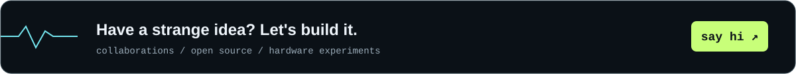

<div align="center">
  
  <br /><br />
  <a href="https://sajalyadav.vercel.app"><b>Portfolio ↗</b></a>
  &nbsp;&nbsp;·&nbsp;&nbsp;
  <a href="https://www.linkedin.com/in/sajal-kumar-6a0b5930a/"><b>LinkedIn</b></a>
  &nbsp;&nbsp;·&nbsp;&nbsp;
  <a href="https://twitter.com/sajalsky1765"><b>X / Twitter</b></a>
  &nbsp;&nbsp;·&nbsp;&nbsp;
  <a href="mailto:sajalkumar1765@gmail.com"><b>Let's talk ↗</b></a>
  <br /><br />
  <sub>AI engineer · Full-stack developer · Web3 builder · Hardware tinkerer</sub>
</div>

<br />

I build agents, apps, and devices that turn interesting problems into useful products. Currently exploring **agentic systems**, **loop engineering**, and **AI × hardware**.

```ts
const sajal = {
  building: ["Bookmark Brain", "AgenPay", "Wisper"],
  exploring: ["agentic systems", "loop engineering", "AI × hardware"],
  openTo: ["collaborations", "open source", "cool ideas"],
  funFact: "I'm hilarious (allegedly).",
};
```

<br />

## 01 / On my workbench

<table>
<tr>
<td width="50%" valign="top">

### 🔖 Bookmark Brain
**Your bookmarks, with a memory.**

Local semantic search over bookmarks using on-device embeddings. A Chrome extension built to find the thing you saved, even when you forget its title.

`Manifest V3` `TypeScript` `On-device AI`

</td>
<td width="50%" valign="top">

### 💸 AgenPay
**Payments that agents can actually make.**

AI-native crypto payment infrastructure on Sei Network, with agent-driven workflows powered by LangGraph.

`Sei Network` `LangGraph` `Web3`

</td>
</tr>
<tr>
<td width="50%" valign="top">

### 🎙️ Wisper
**Capture the conversation. Keep the context.**

A conversation recorder app with a dark, glassy interface, built around capturing the moments worth remembering.

`Conversation capture` `App development`

</td>
<td width="50%" valign="top">

### 🧠 Physical AI Wearable
**Remember the people behind the handshake.**

A wearable that helps you remember who you met, what you discussed, and where to pick up the conversation.

`AI × Hardware` `Wearables`

<sub>Polaris Fellowship 2026 — Round 2</sub>

</td>
</tr>
</table>

[Explore my repositories ↗](https://github.com/ydvSajal?tab=repositories) · [Visit my portfolio ↗](https://sajalyadav.vercel.app)

<br />

## 02 / Tools I reach for

| Layer | Toolkit |
| :--- | :--- |
| **Interfaces** | `Next.js` `React` `TypeScript` `Tailwind CSS` |
| **Backend & data** | `Node.js` `Express` `PostgreSQL` `Prisma` `Supabase` |
| **AI & automation** | `Python` `LangGraph` `n8n` `Make.com` |
| **Web3** | `Solidity` `Sei Network` |
| **Infrastructure** | `Git` `Docker` `AWS` `Vercel` |
| **Hardware** | `ESP32` `Embedded development` |

<br />

## 03 / The build trail

[Repositories ↗](https://github.com/ydvSajal?tab=repositories) &nbsp;·&nbsp; [Contributions ↗](https://github.com/ydvSajal?tab=overview) &nbsp;·&nbsp; [Stars ↗](https://github.com/ydvSajal?tab=stars)

<details>
<summary><b>Watch the contribution snake</b></summary>

<br />

<picture>
  <source media="(prefers-color-scheme: dark)" srcset="https://raw.githubusercontent.com/ydvSajal/ydvSajal/output/github-contribution-grid-snake-dark.svg" />
  <source media="(prefers-color-scheme: light)" srcset="https://raw.githubusercontent.com/ydvSajal/ydvSajal/output/github-contribution-grid-snake.svg" />
  
</picture>

</details>

<br />

## 04 / Start a conversation

Working on an agent, a Web3 product, or a hardware experiment? I'd love to hear about it.

**[Email](mailto:sajalkumar1765@gmail.com)** &nbsp;·&nbsp; **[LinkedIn](https://www.linkedin.com/in/sajal-kumar-6a0b5930a/)** &nbsp;·&nbsp; **[X / Twitter](https://twitter.com/sajalsky1765)** &nbsp;·&nbsp; **[Stack Overflow](https://stackoverflow.com/users/30765158/ydvSajal)**

<br />

<a href="mailto:sajalkumar1765@gmail.com">
  
</a>
